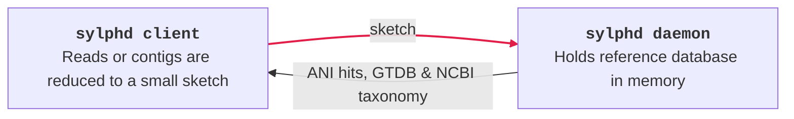
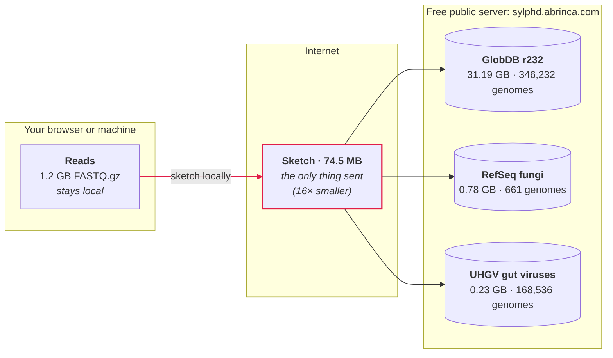

#  sylphd

A small server and client around [sylph](https://github.com/bluenote-1577/sylph): one
long-running server keeps a sylph database in memory, while clients sketch samples locally and
send only the sketches. This avoids paying the database deserialisation cost (about 2 s and 2 GB
of RAM for GTDB r232 c200, more for GlobDB r232) in every process. Results come back as TSV or JSON, joined with GTDB
metadata or another taxonomy source (sylph-tax), and the client can build `sylph-tax`-style
taxonomic profiles.

- **Web app:** <https://abrinca.github.io/sylphd/>: identify an assembly or profile sequencing reads in the browser, backed by the free public server (`sylphd.abrinca.com`).
- **Documentation:** <https://abrinca.github.io/sylphd/docs/>

The client and server speak HTTP over a Unix socket by default; clients can also use a TCP address
or an `http://`/`https://` URL (`--url`). The server has no TLS and no authentication: run it on a
machine you trust, or behind a reverse proxy.

## The idea

`sylphd` grew out of three steps:

### 1. The process was cumbersome

Running `sylph` requires a bash shell, downloading ~20–30 GB of reference databases, enough RAM to
hold them, and learning both `sylph` and `sylph-tax` syntax. That takes at least 30 min to 1 h for
a bioinformatician (even with an LLM agent) and is out of reach for most biologists — and still
leaves you with plain TSV files and no visualisation. Moreover, if you make many separate `sylph`
calls, every call has to deserialise the reference database and load it into memory (~2 s and
~2 GB of RAM per process for GTDB r232 `c=200`, plus the second stage (20 GB for GTDB) on disk), which is slow
and inefficient.

### 2. Split sylph into two processes

Sketching is per-sample CPU work that belongs on the client; keeping database querying in a
long-lived daemon (**`sylphd` = sylph daemon**) lets every run, parallel job and user share a
single resident database — locally for sensitive data, or on a remote server — while returning
GTDB and NCBI taxonomy directly (replacing a separate `sylph-tax` step).



### 3. Only the sketch travels — so a public server makes sense

Once sketching and database lookup were split, it became clear how small sketches are (for example,
74.5 MB for a 1.2 GB `FASTQ.gz` — 16× smaller — and ~0.1 MB for a bacterial assembly), and that
they contain only k-mer hashes and counts, never raw reads. Because neither the reads nor ~32 GB of
reference databases need to move across the network, a free public server (`sylphd.abrinca.com`)
with an in-browser WebAssembly sketcher and interactive visualisations became practical.



| Where | What | Size | Relative to sketch |
|---|---|---:|---:|
| Your browser / machine (stays local) | Sequencing reads (`FASTQ.gz`) | 1.2 GB | 16× larger |
| **Over the internet (sent)** | **Sketch (k-mer hashes & counts)** | **74.5 MB** | **1×** |
| Public server (`sylphd.abrinca.com`) | GlobDB r232 (346,232 genomes) + RefSeq fungi (661) + UHGV gut viruses (168,536) | 32.2 GB | 432× larger |

## Install

Requires Python 3.14, [uv](https://docs.astral.sh/uv/) and a Rust toolchain (the
[pysylph](https://github.com/MrTomRod/pysylph) fork, branch `multi-db`, is built from git at
install time). You also need a sylph database (`.syl2db` or `.syldb`).

```console
git clone https://github.com/Abrinca/sylphd && cd sylphd
uv sync
uv run sylphd --help
```

or, in another project: `uv add "sylphd[client] @ git+https://github.com/Abrinca/sylphd"` (`sylphd[server]` on the
machine that runs the server, `sylphd[taxonomy]` for NCBI taxonomy lookups alone).

If you would rather not install a Rust toolchain, tagged releases carry prebuilt wheels for Linux
x86_64 and aarch64 (CPython 3.14):

```console
uv venv --python 3.14
uv pip install --find-links https://github.com/Abrinca/sylphd/releases/expanded_assets/vX.Y.Z "sylphd[server]==X.Y.Z"
```

Replace `vX.Y.Z` / `X.Y.Z` with the tag and version of a release from the
[releases page](https://github.com/Abrinca/sylphd/releases) (the newest is marked *Latest*).

See [Install from a release](https://abrinca.github.io/sylphd/docs/install/#from-a-release-no-rust-needed)
for the details.

## Quick start

```console
# 1. Get the recommended database (GTDB r232 c200, ~19 GB) and the GTDB metadata
sylphd download --database gtdb-r232-c200-dbv2.syl2db --outdir data
sylphd download --release 232 --outdir data
sylphd setup -m data/bac120_metadata_r232.tsv.gz data/ar53_metadata_r232.tsv.gz \
             -o data/gtdb-r232.sqlite --release 232

# 2. Serve it
sylphd serve --db data/gtdb-r232-c200-dbv2.syl2db --meta data/gtdb-r232.sqlite

# 3. In another shell: sketch locally and ask the server
sylphd query -1 sample_R1.fq.gz -2 sample_R2.fq.gz
sylphd profile -r sample.fq.gz -o sample.profile.tsv
```

`sylphd download --list-databases` shows the other pre-built databases (GTDB r226/r220/r214,
GlobDB r232, viral and eukaryotic catalogues). The public server runs GlobDB r232 (31 GB, needs
8 GiB of RAM) with UHGV and RefSeq fungi; [`deploy/README.md`](deploy/README.md) gives that
configuration and the [GlobDB evaluation](https://abrinca.github.io/sylphd/docs/project/globdb-evaluation/)
compares it with GTDB. They are built and hosted by the
[sylph project](https://sylph-docs.github.io/pre%E2%80%90built-databases/); the downloader uses
[`aria2c`](https://aria2.github.io/) when it is installed and resumes interrupted transfers
otherwise.

The default address is `$XDG_RUNTIME_DIR/sylphd.sock`. To identify an assembly, run
`sylphd assembly assembly.fasta`; it sketches locally, so any server will do.

## Documentation

The [documentation](https://abrinca.github.io/sylphd/docs/) covers installation, a quick start,
guides (profiling reads, identifying an assembly, taxonomic profiles, running a public server),
the commands, the HTTP API, the metadata database and security notes. It is built with
[Zensical](https://zensical.org/) from `docs/`: `uvx zensical serve`.

Coding agents can drive the CLI through a skill: see
[Coding agents](https://abrinca.github.io/sylphd/docs/guides/coding-agents/).

## Development

```console
uv run pytest
```

The tests use pysylph's small test data, copied into `tests/data`.

## How to cite

You are using sylphd. If it helps your research, please cite sylphd, pysylph, sylph (Shaw and Yu,
*Nature Biotechnology* 2024, [doi:10.1038/s41587-024-02412-y](https://doi.org/10.1038/s41587-024-02412-y)),
GlobDB (the database of the public server, CC BY-SA 4.0) and GTDB (its taxonomy). The full list with all references is in the
[documentation](https://abrinca.github.io/sylphd/docs/project/citing/) and at the bottom of the web
app.

## Third-party code

The web page vendors [marked](https://github.com/markedjs/marked) (MIT) and
[DOMPurify](https://github.com/cure53/DOMPurify) (Apache-2.0) to render a server's description
safely; see [`web/vendor/README.md`](web/vendor/README.md). The WebAssembly sketcher in
`sketch-wasm/` ports code from sylph and pysylph (MIT); see its README.

## License

sylphd is licensed under the GNU Affero General Public License, version 3 or later
(AGPL-3.0-or-later); see [`LICENSE`](LICENSE). We are open to negotiating more permissive terms:
<https://abrinca.com/contact>. Use of the public web service is covered by its
[terms](https://abrinca.github.io/sylphd/terms.html).
