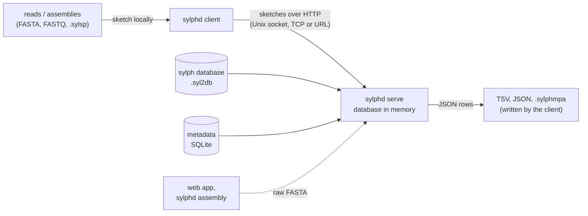

# sylphd

**One sylph database in memory, shared by every run.** `sylphd` is a small server and client around
[sylph](https://github.com/bluenote-1577/sylph). The server loads a database once and keeps it
resident. Clients sketch their samples locally and send only the sketches, then get ANI hits or
taxonomic profiles back as TSV or JSON, joined with GTDB metadata.

A [web app](https://abrinca.github.io/sylphd/) built on the same server finds the closest GTDB
genomes of a pasted assembly, with no install.

## Why a server

Every process that uses [pysylph](https://github.com/althonos/pysylph) deserialises the database
into its own memory. For GTDB r232 at `c=200` that costs about **2 s and 2 GB of RAM per process**
(the screening index; the 20 GB second stage is read lazily from the file and shared through the
page cache). A server pays this once. Runs, parallel jobs and users then share one copy.

Clients send **sketches, not reads**. Sketching is per-sample CPU work and belongs on the client,
and a sketch is small (about 1–2 MB for a 40 Mb read pool). No file paths cross the boundary, and
the server never needs access to your data.

The `assembly` path is the exception: it sends raw sequences because the server does the sketching.
It is opt-in (`--allow-sequences`) and exists for the web app.

## What it does

- **[Profile and query reads](guides/profiling-reads.md).** Single-end, paired, interleaved, several
  files per sample, or ready-made `.sylsp` sketches. Output mirrors sylph's TSV columns plus
  accession and metadata columns.
- **[Identify an assembly](guides/assembly.md).** The closest GTDB genomes, a species assignment at
  95 % ANI and the lineage relation of every hit.
- **[Taxonomic profiles](guides/taxonomic-profiles.md).** `.sylphmpa` files and clade × sample
  matrices in the format of `sylph-tax`, built on the client.
- **[Public server](guides/public-server.md).** TCP and `--url` clients, upload limits, rate limit,
  queue, trusted proxy and CORS, all off by default.

## Where to go next

!!! tip "What does \"same species\" mean?"
    sylphd calls a species at 95 % ANI. That cutoff is a convention, not a law of nature.
    [Species and ANI](species-and-ani.md) explains what the call is based on, where it is
    solid and where it needs care. Read it before you report a species.

- [Install](install.md) and [Quick start](quickstart.md).
- [Commands](commands/serve.md), [HTTP API](reference/http-api.md) and
  [metadata database](reference/metadata.md).
- [Security notes](reference/security.md): there is no authentication by design.
- [Citing](project/citing.md) sylphd, pysylph, sylph and GTDB.

!!! note
    The server speaks plain HTTP, has no TLS and no authentication. Run it on a machine you trust and
    keep the socket in a directory only your group can access. For a public instance, put a reverse
    proxy in front; see [Running a public server](guides/public-server.md).
