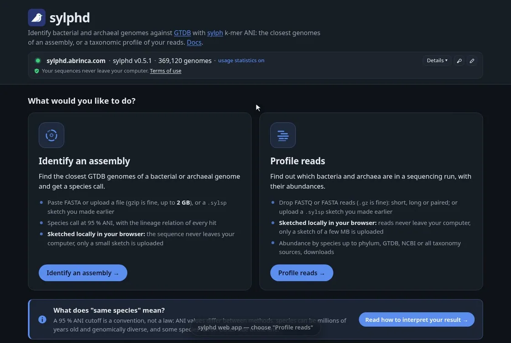
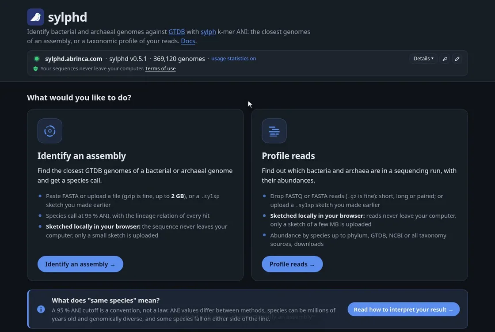
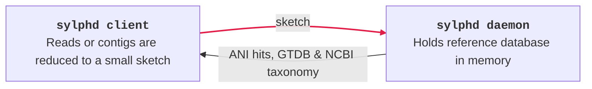

# sylphd

**One sylph database in memory, shared by every run.** `sylphd` is a small server and client around
[sylph](https://github.com/bluenote-1577/sylph). The server loads a database once and keeps it
resident. Clients sketch their samples locally and send only the sketches, then get ANI hits or
taxonomic profiles back as TSV or JSON, joined with GTDB metadata or another taxonomy source
(sylph-tax).

A [web app](https://abrinca.github.io/sylphd/) built on the same server needs no install and has two
modes: it finds the closest GlobDB genomes of an assembly, and it profiles sequencing reads. Both are
sketched [in your browser](guides/profiling-in-browser.md), so the sequences never leave your computer.

=== "Profile reads"

    <figure class="demo-frame">
      
      <figcaption>Sketched locally in WebAssembly (445 MB <code>FASTQ.gz</code> &rarr; 18.8 MB sketch); Bars, Sunburst &amp; Treemap views. <a href="guides/profiling-in-browser/">Read the guide &rarr;</a></figcaption>
    </figure>

=== "Identify an assembly"

    <figure class="demo-frame">
      
      <figcaption>Sketched locally in WebAssembly; species call at 95 % ANI &amp; closest GlobDB genomes. <a href="guides/assembly/#sketching-in-the-browser">Read the guide &rarr;</a></figcaption>
    </figure>

## The idea

`sylphd` grew out of three steps:

### 1. The process was cumbersome

Running `sylph` requires a bash shell, downloading ~20–30 GB of reference databases, enough RAM to
hold them, and learning both `sylph` and `sylph-tax` syntax. This takes at least 30 min to 1 h for
a bioinformatician (even with an LLM agent) and is out of reach for most biologists — and even that
still leaves you with plain TSV files and no visualisation. Moreover, if there are many separate
`sylph` calls (my use case), every call has to deserialise the reference database and load it into
memory, not very efficient.

### 2. Split sylph into two processes

Sketching is independent, per-sample CPU work, while database lookup is read-only against a large
shared index. Splitting them turns `sylph` into a client and a daemon (**`sylphd` = sylph daemon**):

- **Local or remote daemon:** run your own local daemon for sensitive data, or point clients at a
  shared daemon on another machine — every run, parallel job and user shares one database in memory.
- **Built-in taxonomy (replaces `sylph-tax`):** the daemon joins hits with GTDB and NCBI taxonomy
  IDs and names (plus other `sylph-tax` sources), not only the closest genome accession.

### 3. Only the sketch travels — so a public server makes sense

Once sketching and database processes were separated, a second consequence stood out: **sketches
are small**. Sketching a 1.2 GB `FASTQ.gz` read file produces a ~74.5 MB sketch (**16× smaller**),
and a bacterial assembly sketches down to ~0.1 MB. Because a sketch holds only k-mer hashes and
counts — never raw reads or file paths — neither gigabytes of reads nor ~32 GB of reference
databases have to move across the network. That made it practical to run a **free public server**
(`sylphd.abrinca.com`) and pair it with a WebAssembly sketcher and interactive visualisations in
the browser — no shell, no database download, no install, and your reads never leave your computer.

  

    
Local <code>sylphd client</code> <small>your browser / machine</small>

    

      

        

          

          

        

        

          
Reads

          
<strong class="sketch-flow-size">1.2 GB</strong> <small>FASTQ.gz</small>

        

      

      
<strong class="sketch-flow-payoff">Reads stay local</strong> <small>sketching makes them 16&times; smaller!</small>

    

  

  

    
Internet

    

      

        

        
Sketch, <strong class="sketch-flow-size">74.5 MB</strong>

      

      

      

        
<strong class="sketch-flow-payoff">only sketch is sent</strong>

        

      

    

  

  

    
Public <code>sylphd server</code> <small>sylphd.abrinca.com</small>

    

      

      

        

          

          

            
GlobDB r232

            
<strong class="sketch-flow-size">31.19 GB</strong> <small>(346k genomes)</small>

          

        

        

          

          

            
RefSeq fungi

            
<strong class="sketch-flow-size">0.78 GB</strong> <small>(661 genomes)</small>

          

        

        

          

          

            
UHGV viruses

            
<strong class="sketch-flow-size">0.23 GB</strong> <small>(169k genomes)</small>

          

        

      

    

  

The public server (`sylphd.abrinca.com`) holds **GlobDB r232** (346,232 genomes, GTDB taxonomy),
**UHGV** and **RefSeq fungi**. GlobDB data is licensed
[CC BY-SA 4.0](https://creativecommons.org/licenses/by-sa/4.0/); see [Citing](project/citing.md).

Assemblies are sketched locally too (`sylphd assembly`, and the web app in the browser), so a server
started without `--allow-sequences` never receives a sequence. The optional flag adds raw FASTA
uploads for `curl` and scripts; the public instance runs with it.

## What it does

- **[Profile and query reads](guides/profiling-reads.md).** Single-end, paired, interleaved, several
  files per sample, or ready-made `.sylsp` sketches. Output mirrors sylph's TSV columns plus
  accession and metadata columns.
- **[Profile reads in the browser](guides/profiling-in-browser.md).** Drop FASTQ files on the web
  page: they are sketched locally (WebAssembly) and only the sketch is uploaded. Abundance by rank,
  GTDB or NCBI taxonomy, downloads.
- **[Identify an assembly](guides/assembly.md).** The closest GlobDB genomes, a species assignment at
  95 % ANI and the lineage relation of every hit.
- **[Taxonomic profiles](guides/taxonomic-profiles.md).** `.sylphmpa` files and clade × sample
  matrices in the format of `sylph-tax`, aggregated on the server and written by the client.
- **[Public server](guides/public-server.md).** TCP and `--url` clients, upload limits, rate limit,
  queue, trusted proxy and CORS, all off by default.

## Where to go next

!!! tip "What does \"same species\" mean?"
    sylphd calls a species at 95 % ANI. That cutoff is a convention, not a law of nature.
    [Species and ANI](species-and-ani.md) explains what the call is based on, where it is
    solid and where it needs care. Read it before you report a species.

- [Install](install.md) and [Quick start](quickstart.md).
- [Commands](commands/serve.md), [HTTP API](reference/http-api.md) and
  [metadata database](reference/metadata.md).
- [Security notes](reference/security.md): there is no authentication by design.
- [Citing](project/citing.md) sylphd, pysylph, sylph, GlobDB and GTDB.
- [GlobDB evaluation](project/globdb-evaluation.md): why the public server uses GlobDB instead of GTDB, and what it costs in RAM.

!!! note
    The server speaks plain HTTP, has no TLS and no authentication. Run it on a machine you trust and
    keep the socket in a directory only your group can access. For a public instance, put a reverse
    proxy in front; see [Running a public server](guides/public-server.md).
