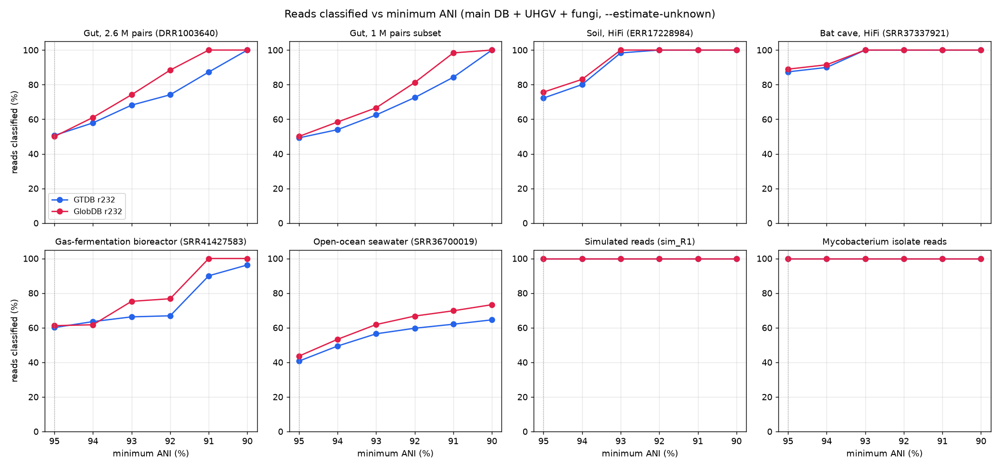
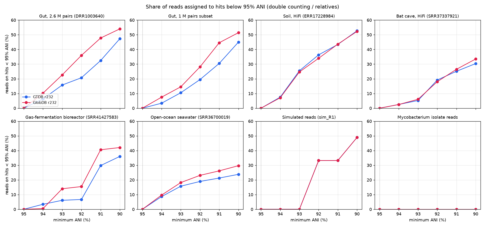
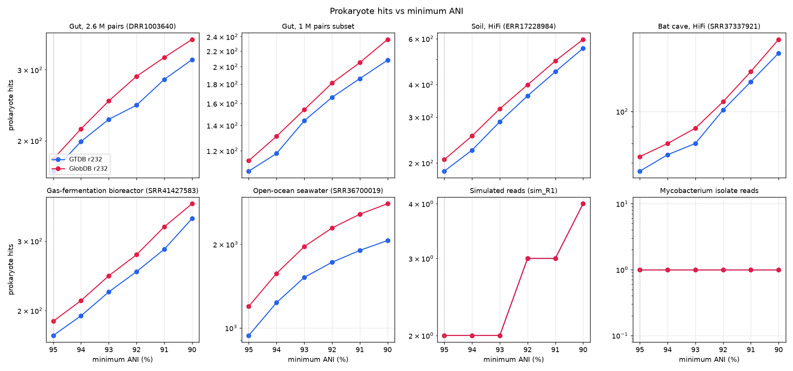
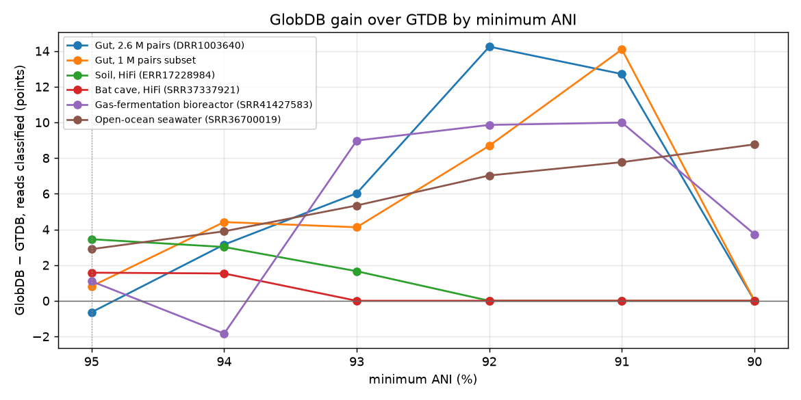

# GlobDB evaluation

The public server moved from GTDB r232 to [GlobDB](https://globdb.org/) r232. This page records the
evaluation behind that decision: how many reads each database classifies, what changes with the
minimum ANI, how much memory each one needs, and whether `sylphd` agrees with stock sylph on
GlobDB. It is meant for users of the public server and for anyone choosing a database for their own
server. The scripts that produced every number are in
[`scripts/benchmarks/globdb/`](https://github.com/Abrinca/sylphd/tree/main/scripts/benchmarks/globdb).

## The two databases

| | GTDB r232 | GlobDB r232 |
|---|---|---|
| Genomes | 199,923 species representatives | 346,232, dereplicated at about 96% ANI |
| Content | GTDB species representatives | all 199,923 GTDB r232 species representatives, with identical lineages, plus about 146k MAGs from other catalogues (MOTU, SPIRE, GCMETA and others) |
| `syl2db` file | 20.0 GB | 31.2 GB |
| Licence | CC BY-SA 4.0 | CC BY-SA 4.0 (attribution required), <https://globdb.org/> |

Because GlobDB contains every GTDB species representative, a read that matched a GTDB genome can
still match it. The extra MAGs add references for organisms that GTDB's species representatives
do not cover, mostly from environmental samples.

## Reads classified

Each configuration is the main prokaryote database plus UHGV and RefSeq fungi, served by
`sylphd serve` with a metadata database and profiled with
`sylphd profile --estimate-unknown` at the default minimum ANI of 95%, from identical pre-made
sketches. "Classified" is sylph's `Sequence_abundance` summed per taxonomy source: its estimate of
the share of reads assigned to some genome.

| Sample | DB | Prokaryotes | UHGV viruses | Fungi | **Total classified** | Δ total | Prokaryote hits | Reads on GlobDB-only MAGs |
|---|---|--:|--:|--:|--:|--:|--:|--:|
| Gut, 2.6 M pairs (DRR1003640) | GTDB | 49.0% | 1.6% | 0.0% | **50.6%** | | 168 | |
| | GlobDB | 48.4% | 1.6% | 0.0% | **50.0%** | −0.6 | 180 | 6.5% |
| Gut, 1 M pairs subset | GTDB | 48.0% | 1.3% | 0.0% | **49.2%** | | 106 | |
| | GlobDB | 48.8% | 1.3% | 0.0% | **50.1%** | +0.8 | 113 | 6.9% |
| Soil, PacBio HiFi (ERR17228984) | GTDB | 72.2% | 0.0% | 0.0% | **72.2%** | | 186 | |
| | GlobDB | 75.7% | 0.0% | 0.0% | **75.7%** | **+3.5** | 206 | 5.6% |
| Bat cave, HiFi (SRR37337921) | GTDB | 81.9% | 0.0% | 5.4% | **87.4%** | | 66 | |
| | GlobDB | 83.5% | 0.0% | 5.4% | **89.0%** | **+1.6** | 73 | 3.4% |
| Gas-fermentation bioreactor (SRR41427583) | GTDB | 60.0% | 0.1% | 0.0% | **60.1%** | | 173 | |
| | GlobDB | 61.1% | 0.1% | 0.0% | **61.2%** | **+1.1** | 188 | 6.8% |
| Open-ocean seawater (SRR36700019) | GTDB | 40.6% | 0.0% | 0.1% | **40.7%** | | 939 | |
| | GlobDB | 43.5% | 0.0% | 0.1% | **43.6%** | **+2.9** | **1,196** | 10.7% |
| Simulated reads (two genomes) | both | 99.4% | 0.6% | 0.0% | 100.0% | 0 | 2 | – |
| *Mycobacterium* isolate reads | both | 100.0% | 0.0% | 0.0% | 100.0% | 0 | 1 | – |

The gut sample is a human gut metagenome (Illumina, 2.6 M read pairs, and a 1 M-pair subset); the
soil and bat-cave samples are PacBio HiFi reads; the bioreactor (gas fermentation) and open-ocean
seawater samples are paired Illumina reads.

- UHGV and fungi are the same in both configurations; only the prokaryote database changes.
- The two gut rows move in opposite directions (−0.6 and +0.8), so about ±1 point is the noise of
  sylph's unknown-fraction estimate.
- "Reads on GlobDB-only MAGs" are reads assigned to GlobDB genomes that are not GTDB r232
  species representatives (genomes without a GCA or GCF accession).
- Species lost and gained (GTDB-only and GlobDB-only species, with the share of reads that
  went to the GTDB-only ones): gut 38 / 50 (7.1%), soil 8 / 28 (1.9%), bat cave 4 / 11 (1.8%),
  bioreactor 8 / 23 (5.7%), ocean 119 / 376 (3.6%). The species that are lost are mostly ones whose
  reads went to a closer GlobDB MAG.
- Profiling time on the server (warm, same machine, with other load): GlobDB between about 20%
  slower and on par with GTDB.

**Summary.** Every environmental sample gained: +1.1 to +3.5 points classified, 7–27% more
prokaryote species, and closer references (for example MAGs at 99.7% ANI). The gut and isolate
samples neither gain nor lose. The costs are 8 GiB of RAM instead of 6 GiB, 11 GB more disk, a
single download host without checksums, the CC BY-SA 4.0 attribution requirement, and more species
that are named by a MAG identifier (see [Metadata](#metadata-for-genomes-without-an-ncbi-record)).
We judged this worth it for a general-purpose public server. If your samples are human gut
metagenomes or isolates, GTDB r232 does as well and needs less memory.

## Minimum ANI: 95 or lower?

sylph's profiling default is a minimum ANI of 95%, and so is `sylphd profile`'s; `sylphd query`
(ANI search) defaults to 90%. We swept the minimum ANI from 90 to 95 for both databases, same
sketches, same options. The full table, 96 rows, is
[`ani_sweep.tsv`](../data/globdb/ani_sweep.tsv).

Lowering the threshold makes the classified share climb steeply, to 100% for several samples. **These
totals are not comparable with the 95% ones, and the rise is not a sign that more reads are
explained.** Below about 95% ANI:

- sylph reports close relatives of a genome that is present as hits of their own, each with its own
  coverage, so the same reads are credited to the genome and to its relatives;
- `--estimate-unknown` then counts those reads more than once, and the total is capped at 100%;
- the simulated sample (two real Enterobacteriaceae genomes at 95.1% and 98.3% ANI) shows this
  cleanly. From 92% on it gets false relatives, first one and then two extra hits at 92.3% and
  90.5%. At 90% those take 48.9% of the reads, which roughly halves the true abundances.

| Sample (90% minimum ANI) | GTDB total | GlobDB total | Reads on hits < 95% ANI, GTDB / GlobDB |
|---|--:|--:|--:|
| Gut, 2.6 M pairs | 100.0% | 100.0% | 47.3% / 54.0% |
| Soil, HiFi | 100.0% | 100.0% | 52.7% / 52.3% |
| Bat cave, HiFi | 100.0% | 100.0% | 30.4% / 33.5% |
| Bioreactor | 96.3% | 100.0% | 36.0% / 42.1% |
| Open ocean | 64.5% | 73.3% | 23.8% / 29.7% |

Prokaryote hits grow from 939 to 2,063 (GTDB) and from 1,196 to 2,799 (GlobDB) in the ocean sample
between 95% and 90%. In profiling mode a lower threshold mostly adds false positives and distorts
abundances. For that reason **95% stays the default for profiling**. Use a lower threshold when you
want to find distant relatives of a genome, which is what `sylphd query` (default 90%) is for;
see [Species and ANI](../species-and-ani.md).

GlobDB's gain over GTDB persists at lower thresholds (for example +8.8 points in the ocean sample
at 90%), but those numbers are inflated in the same way. Where both curves reach 100%, the gain
falls to zero by construction.

## Memory

`sylphd serve` loads the screening index of each database into RAM and reads the dense sketches
from the file on demand. We ran the server in a rootless podman container under hard cgroup v2
limits (`--memory X --memory-swap X`, no swap), from 3 GiB up to unlimited, with the database files
dropped from the page cache before each run. Two configurations were tested: the GTDB
configuration (GTDB r232 + UHGV + fungi) and the GlobDB configuration (GlobDB r232 + UHGV + fungi).

| | GTDB configuration | GlobDB configuration |
|---|---|---|
| Database files | 20.0 GB + 0.2 + 0.8 | 31.2 GB + 0.2 + 0.8 |
| Anonymous RAM after loading | 3.07 GiB | 4.15 GiB |
| Highest anonymous RAM while loading | 4.6–5.2 GiB (transient) | 6.9–7.2 GiB (transient) |
| **Lowest limit that starts** | **5.25 GiB** (5.0 GiB is killed during loading) | **7.5 GiB** (7.25 GiB is killed during loading) |
| Startup peak, no limit (`memory.peak`) | 8.2 GiB | 9.8–10.0 GiB |
| Page cache the samples actually used | 0.27 GiB | 0.54 GiB |
| **Recommended `MemoryMax`** | **6 GiB** | **8 GiB** (10 GiB is comfortable) |

- **Loading sets the limit.** The floor is the transient while the screening index is built, not
  the steady-state size, not the size of the files and not the page cache. Below the floor the
  server is killed during startup and never answers, so a systemd unit with `Restart=` would loop.
- **Above the floor the latency is flat.** Warm profiling of the 0.25 M-pair gut sample took 709 ms at
  5.25 GiB and 698 ms with no limit (GTDB configuration), and 868 ms at 7.5 GiB and 893 ms with no
  limit (GlobDB configuration). The answers were identical at every limit.
- **The page cache needed was small.** Profiling read about 290 MB of the 20 GB file for the five
  GTDB-configuration samples and 580 MB of the 31 GB file for the GlobDB ones. Losing that cache entirely cost
  15–20% on the largest gut sample and about 3× on a small one, but this happens only with less
  headroom than the server needs to start at all.
- A GlobDB server needs about 1.1 GiB more anonymous RAM after loading and a 2.25 GiB higher floor.

**Caveats.**

- One workload shape: five sketches, three of them from one human gut metagenome (0.25 M, 1 M and 2.6 M
  read pairs) plus two small samples, with at most two requests in flight. The page cache is
  needed in proportion to the number of *different* samples served and the genomes they hit; a
  public server that sees thousands of different samples should budget a few GiB more than the
  numbers above. Soil, ocean and other samples with many hits were not part of this test.
- No `/contigs`, no taxonomy files and no metadata database were loaded; a metadata database
  adds a SQLite file and its page cache.
- The host was shared with other work during part of the session. Warm latencies reproduce to about
  2%, but cold latencies and startup times vary by up to ±50% between identical runs; several limits
  were re-run for that reason.
- OOM-killed runs have no cgroup statistics (the container's cgroup is gone), so their peaks are
  the last `memory.current` sample at 4 Hz.
- Nothing between 5.0 and 5.25 GiB (GTDB configuration) was tried.

## Parity with stock sylph

To check that GlobDB results from `sylphd` are the ones sylph would give, we compared `sylphd` with
stock sylph 1.0.0 and sylph-tax 1.9.2 on GlobDB alone, with four samples: soil (HiFi), bat cave
(HiFi), bioreactor (paired) and open-ocean seawater (paired).

- **Same sketch, same result.** Profiling the same sketch gives identical hits and identical
  numbers.
- **`sylphd`'s own sketches.** For single-end reads (soil, bat cave) the sketches and profiles
  are identical. For paired-end reads the largest difference was 0.16 points of ANI and 0.05 points of
  abundance. The cause is in stock sylph's paired-end deduplication, which is a probabilistic,
  multithreaded filter: two runs of stock sylph on the same reads differed in 2 k-mer counts, and
  `sylphd`'s sketching library (pysylph) differed from stock in 2,231 of 21.5 M k-mer counts, while giving
  identical sketches on repeated runs.
- **Taxonomic profiles.** They differ only by rounding, because sylph-tax sums the already rounded
  values of the TSV.
- **TSV formatting.** sylph writes `HIGH`/`LOW` in `Eff_lambda` and `NA-NA` in the interval columns
  where `sylphd` used to leave them empty. Fixed: the TSV is now byte-identical to sylph's for the
  sylph columns (see `tests/test_sylph_compat.py`).

## Metadata for genomes without an NCBI record

Two things changed in the metadata database with the switch, and are documented in the
[metadata reference](../reference/metadata.md):

- GlobDB names genomes by accession without a version (`GCA_041167105`), while GTDB's metadata is
  keyed with one (`GCA_041167105.1`). An unversioned accession now resolves to the metadata row of
  its base when exactly one version counts, so all 199,923 GlobDB `GCA_` and `GCF_` genomes get their
  GTDB metadata and NCBI taxids. See [Resolving a hit](../reference/metadata.md#resolving-a-hit).
- The roughly 146k MAGs without an NCBI record get a *nearest NCBI taxon*, voted by their GTDB
  clade, stored as the raw consensus node plus the formally named ancestor next to it. See
  [Nearest NCBI taxa](../reference/metadata.md#nearest-ncbi-taxa).

## Running it yourself

[`scripts/benchmarks/globdb/`](https://github.com/Abrinca/sylphd/tree/main/scripts/benchmarks/globdb)
has the comparison runner, the ANI sweep and its plots, the parity check and the memory benchmark,
with a README on rerunning them against your own databases and samples. To choose a database
for your own server, run the comparison on a handful of samples that look like yours: the
classified share and the number of species lost are the two numbers to compare. The memory
benchmark's `run_ladder.sh` finds the floor for your own database set.

For exposing a server to other people, see [Running a public server](../guides/public-server.md).
